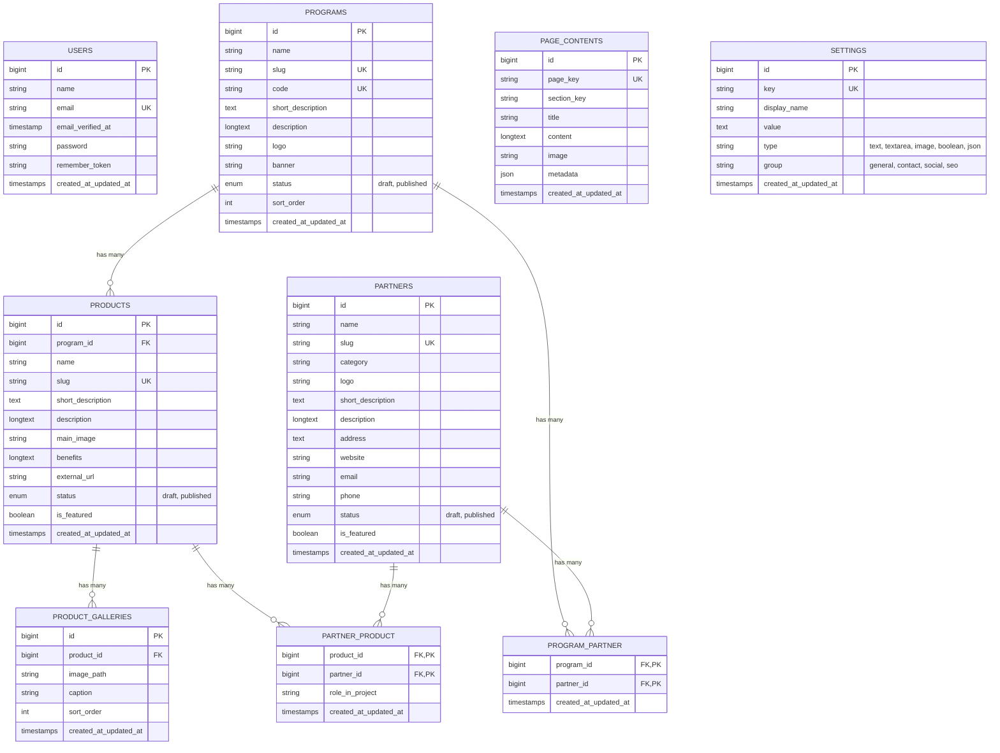

# DOKUMEN DESAIN DATABASE & KAMUS DATA
# WEBSITE PUSKOR (PUSAT KOORDINASI PENGEMBANGAN DAN PENERAPAN TEKNOLOGI)
### Universitas Jenderal Soedirman

**Versi:** 1.0  
**Database Engine:** MySQL 8.0+  
**ORM:** Laravel Eloquent  
**Karakter Set / Collation:** `utf8mb4_unicode_ci`

---

## 1. ENTITY RELATIONSHIP DIAGRAM (ERD)

Berikut adalah diagram relasi entitas database PUSKOR:



---

## 2. KAMUS DATA (DATA DICTIONARY)

### 2.1 Tabel `users`
Menyimpan akun administrator pengelola website PUSKOR.

| Nama Kolom | Tipe Data | Nullable | Default | Keterangan |
|---|---|---|---|---|
| `id` | BIGINT UNSIGNED | No | Auto Increment | Primary Key |
| `name` | VARCHAR(255) | No | - | Nama lengkap admin |
| `email` | VARCHAR(255) | No | - | Email login (Unique) |
| `email_verified_at` | TIMESTAMP | Yes | NULL | Tanggal verifikasi email |
| `password` | VARCHAR(255) | No | - | Hashed password |
| `remember_token` | VARCHAR(100) | Yes | NULL | Token session "Remember Me" |
| `created_at` | TIMESTAMP | Yes | NULL | Waktu pembuatan akun |
| `updated_at` | TIMESTAMP | Yes | NULL | Waktu pembaruan akun |

---

### 2.2 Tabel `programs`
Menyimpan data 4 program utama PUSKOR (SINERGI, AJAKAN INDUSTRI, PMUPUD, DORTEK) serta program masa depan.

| Nama Kolom | Tipe Data | Nullable | Default | Keterangan |
|---|---|---|---|---|
| `id` | BIGINT UNSIGNED | No | Auto Increment | Primary Key |
| `name` | VARCHAR(255) | No | - | Nama resmi program (misal: "SINERGI") |
| `slug` | VARCHAR(255) | No | - | URL slug unik (misal: "sinergi") |
| `code` | VARCHAR(50) | Yes | NULL | Kode program internal (misal: "SIN") |
| `short_description` | TEXT | No | - | Deskripsi ringkas untuk card/overview |
| `description` | LONGTEXT | No | - | Deskripsi lengkap, latar belakang & tujuan (HTML/Markdown) |
| `logo` | VARCHAR(255) | Yes | NULL | Path logo program (di storage) |
| `banner` | VARCHAR(255) | Yes | NULL | Path banner hero program |
| `status` | ENUM('draft', 'published') | No | 'published' | Status publikasi |
| `sort_order` | INT | No | 0 | Urutan penayangan di website |
| `created_at` | TIMESTAMP | Yes | NULL | Waktu dibuat |
| `updated_at` | TIMESTAMP | Yes | NULL | Waktu diupdate |

---

### 2.3 Tabel `products`
Menyimpan seluruh katalog produk hasil inovasi dan penerapan teknologi dari program-program PUSKOR.

| Nama Kolom | Tipe Data | Nullable | Default | Keterangan |
|---|---|---|---|---|
| `id` | BIGINT UNSIGNED | No | Auto Increment | Primary Key |
| `program_id` | BIGINT UNSIGNED | No | - | Foreign Key ke `programs.id` (ON DELETE RESTRICT) |
| `name` | VARCHAR(255) | No | - | Nama produk teknologi / inovasi |
| `slug` | VARCHAR(255) | No | - | URL slug unik (misal: "alat-pengering-gabah-solar") |
| `short_description` | TEXT | No | - | Deskripsi ringkas untuk card katalog |
| `description` | LONGTEXT | No | - | Deskripsi mendalam mengenai inovasi |
| `main_image` | VARCHAR(255) | No | - | Path foto utama produk |
| `benefits` | LONGTEXT | Yes | NULL | Fungsi, manfaat, dan spesifikasi teknis |
| `external_url` | VARCHAR(500) | Yes | NULL | Tautan eksternal (video demo, paten, jurnal, web) |
| `is_featured` | BOOLEAN | No | 0 | Tampilkan di section "Produk Unggulan" beranda |
| `status` | ENUM('draft', 'published') | No | 'published' | Status publikasi |
| `created_at` | TIMESTAMP | Yes | NULL | Waktu dibuat |
| `updated_at` | TIMESTAMP | Yes | NULL | Waktu diupdate |

---

### 2.4 Tabel `product_galleries`
Menyimpan banyak foto pendukung/dokumentasi untuk masing-masing produk inovasi.

| Nama Kolom | Tipe Data | Nullable | Default | Keterangan |
|---|---|---|---|---|
| `id` | BIGINT UNSIGNED | No | Auto Increment | Primary Key |
| `product_id` | BIGINT UNSIGNED | No | - | Foreign Key ke `products.id` (ON DELETE CASCADE) |
| `image_path` | VARCHAR(255) | No | - | Path file gambar dokumentasi di storage |
| `caption` | VARCHAR(255) | Yes | NULL | Keterangan gambar |
| `sort_order` | INT | No | 0 | Urutan foto dalam galeri |
| `created_at` | TIMESTAMP | Yes | NULL | Waktu diunggah |
| `updated_at` | TIMESTAMP | Yes | NULL | Waktu diupdate |

---

### 2.5 Tabel `partners`
Menyimpan profil institusi, industri, dinas, atau UMKM mitra kolaborasi PUSKOR.

| Nama Kolom | Tipe Data | Nullable | Default | Keterangan |
|---|---|---|---|---|
| `id` | BIGINT UNSIGNED | No | Auto Increment | Primary Key |
| `name` | VARCHAR(255) | No | - | Nama resmi mitra kolaborator |
| `slug` | VARCHAR(255) | No | - | URL slug unik (misal: "pt-inka-persero") |
| `category` | VARCHAR(100) | Yes | NULL | Kategori (Industri, BUMN, Pemerintah, UMKM, Lembaga Riset) |
| `logo` | VARCHAR(255) | No | - | Path file logo resmi mitra |
| `short_description` | TEXT | Yes | NULL | Gambaran ringkas profil mitra |
| `description` | LONGTEXT | Yes | NULL | Profil lengkap dan keterlibatan kolaborasi |
| `address` | TEXT | Yes | NULL | Alamat kantor/pusat |
| `website` | VARCHAR(255) | Yes | NULL | URL resmi website mitra |
| `email` | VARCHAR(255) | Yes | NULL | Email kontak resmi |
| `phone` | VARCHAR(50) | Yes | NULL | Nomor kontak/telepon |
| `is_featured` | BOOLEAN | No | 0 | Tampilkan di section "Mitra Kolaborasi" beranda |
| `status` | ENUM('draft', 'published') | No | 'published' | Status publikasi |
| `created_at` | TIMESTAMP | Yes | NULL | Waktu dibuat |
| `updated_at` | TIMESTAMP | Yes | NULL | Waktu diupdate |

---

### 2.6 Tabel Pivot `program_partner`
Menghubungkan relasi Many-to-Many antara Program PUSKOR dan Mitra.

| Nama Kolom | Tipe Data | Nullable | Default | Keterangan |
|---|---|---|---|---|
| `program_id` | BIGINT UNSIGNED | No | - | Foreign Key ke `programs.id` (CASCADE) |
| `partner_id` | BIGINT UNSIGNED | No | - | Foreign Key ke `partners.id` (CASCADE) |
| `created_at` | TIMESTAMP | Yes | NULL | Waktu asosiasi |
| `updated_at` | TIMESTAMP | Yes | NULL | Waktu asosiasi |

*Catatan: Primary Key Komposit `(program_id, partner_id)`.*

---

### 2.7 Tabel Pivot `partner_product`
Menghubungkan relasi Many-to-Many antara Produk dan Mitra kolaborator.

| Nama Kolom | Tipe Data | Nullable | Default | Keterangan |
|---|---|---|---|---|
| `product_id` | BIGINT UNSIGNED | No | - | Foreign Key ke `products.id` (CASCADE) |
| `partner_id` | BIGINT UNSIGNED | No | - | Foreign Key ke `partners.id` (CASCADE) |
| `role_in_project` | VARCHAR(150) | Yes | NULL | Peran mitra (misal: "Penyedia Bahan Baku", "Uji Lapang") |
| `created_at` | TIMESTAMP | Yes | NULL | Waktu asosiasi |
| `updated_at` | TIMESTAMP | Yes | NULL | Waktu asosiasi |

*Catatan: Primary Key Komposit `(product_id, partner_id)`.*

---

### 2.8 Tabel `page_contents`
Menyimpan konten CMS modular untuk halaman beranda, tentang kami, dan footer.

| Nama Kolom | Tipe Data | Nullable | Default | Keterangan |
|---|---|---|---|---|
| `id` | BIGINT UNSIGNED | No | Auto Increment | Primary Key |
| `page_key` | VARCHAR(100) | No | - | Kunci halaman (misal: `home`, `about`, `footer`) |
| `section_key` | VARCHAR(100) | No | - | Kunci bagian (misal: `hero`, `vision_mission`, `overview`) |
| `title` | VARCHAR(255) | Yes | NULL | Judul bagian |
| `content` | LONGTEXT | Yes | NULL | Konten teks / HTML |
| `image` | VARCHAR(255) | Yes | NULL | Path gambar aset pendukung |
| `metadata` | JSON | Yes | NULL | Atribut fleksibel (misal tombol link CTA, label) |
| `created_at` | TIMESTAMP | Yes | NULL | Waktu dibuat |
| `updated_at` | TIMESTAMP | Yes | NULL | Waktu diupdate |

*Catatan: Unique constraint komposit pada `(page_key, section_key)`.*

---

### 2.9 Tabel `settings`
Menyimpan variabel konfigurasi global website (nama web, kontak, sosial media, tracking ID).

| Nama Kolom | Tipe Data | Nullable | Default | Keterangan |
|---|---|---|---|---|
| `id` | BIGINT UNSIGNED | No | Auto Increment | Primary Key |
| `key` | VARCHAR(100) | No | - | Key unik (misal: `contact_email`, `site_name`) |
| `display_name` | VARCHAR(150) | No | - | Label terbaca manusia di dashboard admin |
| `value` | TEXT | Yes | NULL | Nilai konfigurasi |
| `type` | VARCHAR(50) | No | 'text' | Tipe input admin (`text`, `textarea`, `image`, `json`) |
| `group` | VARCHAR(50) | No | 'general' | Pengelompokan tab (`general`, `contact`, `seo`, `social`) |
| `created_at` | TIMESTAMP | Yes | NULL | Waktu dibuat |
| `updated_at` | TIMESTAMP | Yes | NULL | Waktu diupdate |

---

## 3. SPESIFIKASI MIGRATION LARAVEL

Berikut adalah cuplikan kode migrasi standar Laravel untuk skema di atas:

### Migration `create_programs_table.php`
```php
Schema::create('programs', function (Blueprint $table) {
    $table->id();
    $table->string('name');
    $table->string('slug')->unique();
    $table->string('code')->nullable();
    $table->text('short_description');
    $table->longText('description');
    $table->string('logo')->nullable();
    $table->string('banner')->nullable();
    $table->enum('status', ['draft', 'published'])->default('published')->index();
    $table->integer('sort_order')->default(0);
    $table->timestamps();
});
```

### Migration `create_products_table.php`
```php
Schema::create('products', function (Blueprint $table) {
    $table->id();
    $table->foreignId('program_id')->constrained('programs')->onDelete('restrict');
    $table->string('name')->index();
    $table->string('slug')->unique();
    $table->text('short_description');
    $table->longText('description');
    $table->string('main_image');
    $table->longText('benefits')->nullable();
    $table->string('external_url', 500)->nullable();
    $table->boolean('is_featured')->default(false)->index();
    $table->enum('status', ['draft', 'published'])->default('published')->index();
    $table->timestamps();
});
```

### Migration `create_partners_table.php`
```php
Schema::create('partners', function (Blueprint $table) {
    $table->id();
    $table->string('name')->index();
    $table->string('slug')->unique();
    $table->string('category')->nullable()->index();
    $table->string('logo');
    $table->text('short_description')->nullable();
    $table->longText('description')->nullable();
    $table->text('address')->nullable();
    $table->string('website')->nullable();
    $table->string('email')->nullable();
    $table->string('phone', 50)->nullable();
    $table->boolean('is_featured')->default(false)->index();
    $table->enum('status', ['draft', 'published'])->default('published')->index();
    $table->timestamps();
});
```

---

## 4. DATA AWAL (SEEDERS SPECIFICATION)

### 4.1 Program Awal (4 Pilar Utama PUSKOR)
Database Seeder (`ProgramSeeder.php`) wajib menginisialisasi 4 program utama berikut:

```php
$programs = [
    [
        'name' => 'SINERGI',
        'slug' => 'sinergi',
        'code' => 'SIN',
        'short_description' => 'Program kolaborasi riset strategis dan transfer teknologi terpadu antara akademisi UNSOED, masyarakat, dan industri.',
        'description' => 'SINERGI adalah program unggulan PUSKOR UNSOED yang mengintegrasikan kapabilitas riset universitas dengan kebutuhan riil pemangku kepentingan untuk menghasilkan inovasi terapan yang aplikatif dan berdampak.',
        'status' => 'published',
        'sort_order' => 1,
    ],
    [
        'name' => 'AJAKAN INDUSTRI',
        'slug' => 'ajakan-industri',
        'code' => 'AI',
        'short_description' => 'Inisiatif kemitraan strategis yang menghubungkan tantangan industri komersial dengan solusi teknologi tepat guna kampus.',
        'description' => 'Program AJAKAN INDUSTRI memfasilitasi penjajakan, perancangan prototipe industri, hingga komersialisasi teknologi bersama mitra korporasi nasional dan regional.',
        'status' => 'published',
        'sort_order' => 2,
    ],
    [
        'name' => 'PMUPUD',
        'slug' => 'pmupud',
        'code' => 'PMU',
        'short_description' => 'Program Pengembangan Usaha Produk Unggulan Daerah berbasis riset teknologi tepat guna UNSOED.',
        'description' => 'PMUPUD berfokus pada pendampingan UMKM dan kelompok produsen lokal untuk meningkatkan kapasitas produksi dan nilai tambah komoditas unggulan Banyumas dan sekitarnya.',
        'status' => 'published',
        'sort_order' => 3,
    ],
    [
        'name' => 'DORTEK',
        'slug' => 'dortek',
        'code' => 'DOR',
        'short_description' => 'Diseminasi dan Orientasi Teknologi untuk percepatan adopsi inovasi di komunitas masyarakat pedesaan.',
        'description' => 'DORTEK menghadirkan teknologi ramah lingkungan yang mudah dioperasikan langsung ke tengah masyarakat tani, nelayan, dan peternak guna mempercepat kemandirian ekonomi.',
        'status' => 'published',
        'sort_order' => 4,
    ],
];
```

### 4.2 Akun Admin Awal
- **Email:** `admin.puskor@unsoed.ac.id`
- **Nama:** Administrator PUSKOR UNSOED
- **Role:** Superadmin

