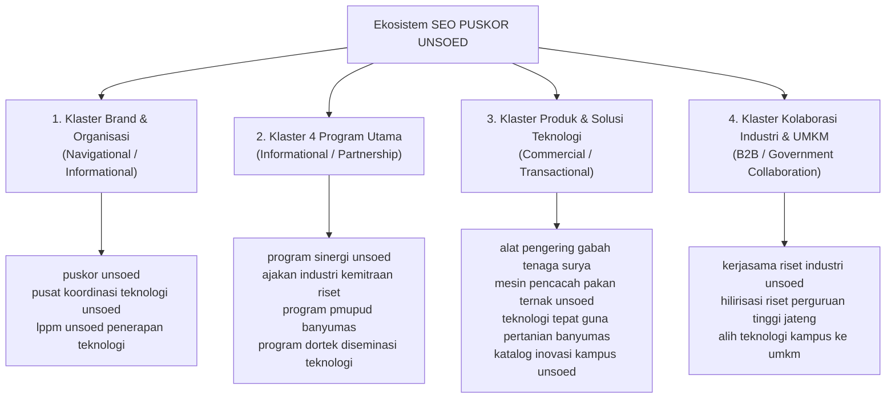

# PANDUAN STRATEGI & SPESIFIKASI SEO SPESIALIST
# WEBSITE PUSKOR (PUSAT KOORDINASI PENGEMBANGAN DAN PENERAPAN TEKNOLOGI)
### Universitas Jenderal Soedirman

**Versi:** 1.0  
**Peran:** Senior Technical & Content SEO Specialist  
**Domain Utama:** `puskor.unsoed.ac.id` (atau portal terintegrasi UNSOED)  
**Target Search Engine:** Google Indonesia (Prioritas Utama) & Global Google Search

---

## 1. MISI & TANGGUNG JAWAB SEO SPESIALIST PUSKOR

Sebagai **SEO Specialist** untuk Website PUSKOR Universitas Jenderal Soedirman, misi utamanya adalah:
1. **Meningkatkan Visibilitas Hilirisasi Inovasi Kampus**: Memastikan setiap hasil riset terapan, prototipe teknologi, dan produk yang dikembangkan oleh sivitas akademika UNSOED dapat ditemukan dengan mudah oleh pihak industri, kementerian/pemerintah daerah, petani/nelayan, UMKM, dan masyarakat luas di mesin pencari.
2. **Menjembatani Pencari Solusi Teknologi ke Kampus**: Menangkap *search intent* komersial, agrikultur, industri, dan pemberdayaan masyarakat sehingga memicu kemitraan riset baru melalui 4 program utama (SINERGI, AJAKAN INDUSTRI, PMUPUD, DORTEK).
3. **Memperkuat Otoritas Institusional Digital**: Memanfaatkan otoritas domain akademik `unsoed.ac.id` (`.ac.id` memiliki trust score tinggi di Google) untuk mendominasi kata kunci teknologi tepat guna (TTG) dan alih teknologi di Indonesia.

---

## 2. RISET KATA KUNCI & PEMETAAN KLASTER TOPIK (KEYWORD STRATEGY)

Pencarian diklasifikasikan ke dalam 4 pilar klaster utama berdasarkan *Search Intent*:



### Tabel Rencana Kata Kunci (Keyword Targeting Matrix)

| Kata Kunci Target | Volume / Bulan | Search Intent | Halaman Tujuan (Landing Page) | Prioritas |
|---|---|---|---|---|
| `puskor unsoed` | Brand | Navigational | `/` (Beranda) | P0 (Kritis) |
| `pusat koordinasi pengembangan dan penerapan teknologi unsoed` | Brand | Navigational | `/tentang-puskor` | P0 |
| `program sinergi unsoed` | Niche | Informational | `/program/sinergi` | P1 |
| `ajakan industri unsoed` | Niche | Commercial | `/program/ajakan-industri` | P1 |
| `program pmupud unsoed` | Niche | Informational | `/program/pmupud` | P1 |
| `program dortek unsoed` | Niche | Informational | `/program/dortek` | P1 |
| `katalog inovasi teknologi unsoed` | Menengah | Commercial | `/produk` | P0 (Kritis) |
| `teknologi tepat guna banyumas` | Menengah | Informational | `/produk` & `/program/dortek` | P1 |
| `kerjasama riset industri kampus purwokerto` | Menengah | Commercial Investigation | `/mitra` & Kontak | P1 |
| `[nama produk inovasi spesifik]` | Sangat Spesifik | Commercial / Solusi | `/produk/[slug-produk]` | P0 (Kritis) |

---

## 3. TECHNICAL SEO BLUEPRINT (LARAVEL + INERTIA.JS + VUE 3)

### 3.1 Penanganan Client-Side Rendering (CSR) vs Search Crawler
Inertia.js memuat halaman secara dinamis di sisi klien (SPA). Untuk menjamin Googlebot dan bot media sosial (WhatsApp, Facebook, Twitter/X, LinkedIn) membaca metadata secara akurat 100%:

1. Gunakan komponen `<Head>` bawaan `@inertiajs/vue3` di setiap halaman publik.
2. Sertakan fallback server-rendered meta tag pada root template Blade Laravel (`resources/views/app.blade.php`).

#### Implementasi Komponen `<Head>` di Vue 3 Halaman Detail Produk (`Public/Products/Show.vue`):

```vue
<script setup>
import { Head } from '@inertiajs/vue3';

const props = defineProps({
  product: Object,
  seo: Object
});
</script>

<template>
  <Head>
    <!-- Title Tag Dinamis -->
    <title>{{ seo.title }}</title>
    <meta name="description" :content="seo.description" />
    <link rel="canonical" :href="seo.canonical_url" />

    <!-- Open Graph (Facebook / WhatsApp / LinkedIn) -->
    <meta property="og:type" content="product" />
    <meta property="og:title" :content="seo.title" />
    <meta property="og:description" :content="seo.description" />
    <meta property="og:url" :content="seo.canonical_url" />
    <meta property="og:image" :content="seo.image_url" />
    <meta property="og:site_name" content="PUSKOR Universitas Jenderal Soedirman" />

    <!-- Twitter Card -->
    <meta name="twitter:card" content="summary_large_image" />
    <meta name="twitter:title" :content="seo.title" />
    <meta name="twitter:description" :content="seo.description" />
    <meta name="twitter:image" :content="seo.image_url" />

    <!-- JSON-LD Structured Data Schema.org -->
    <component :is="'script'" type="application/ld+json">
      {{ JSON.stringify(seo.schema_json_ld) }}
    </component>
  </Head>

  <PublicLayout>
    <!-- Konten Halaman Detail Produk -->
  </PublicLayout>
</template>
```

---

### 3.2 Dynamic XML Sitemap (`/sitemap.xml`)
Sitemap harus dibuat secara otomatis dari database dan di-cache per 24 jam.

#### Kode Controller Laravel: `app/Http/Controllers/Public/SeoController.php`
```php
namespace App\Http\Controllers\Public;

use App\Http\Controllers\Controller;
use App\Models\Program;
use App\Models\Product;
use App\Models\Partner;
use Illuminate\Http\Response;
use Illuminate\Support\Facades\Cache;

class SeoController extends Controller
{
    public function sitemap(): Response
    {
        $content = Cache::remember('sitemap_xml', 86400, function () {
            $programs = Program::where('status', 'published')->get();
            $products = Product::where('status', 'published')->get();
            $partners = Partner::where('status', 'published')->get();

            return view('seo.sitemap', compact('programs', 'products', 'partners'))->render();
        });

        return response($content, 200)->header('Content-Type', 'application/xml');
    }

    public function robots(): Response
    {
        $robots = "User-agent: *\n";
        $robots .= "Allow: /\n";
        $robots .= "Disallow: /admin/\n";
        $robots .= "Disallow: /login\n";
        $robots .= "Disallow: /storage/temp/\n\n";
        $robots .= "Sitemap: " . url('/sitemap.xml') . "\n";

        return response($robots, 200)->header('Content-Type', 'text/plain');
    }
}
```

---

### 3.3 Structured Data / Schema.org (JSON-LD) Spesifikasi Institusi

Setiap halaman wajib menyematkan JSON-LD terstruktur untuk mengaktifkan *Google Rich Results*:

#### A. Schema untuk Organisasi PUSKOR (`EducationalOrganization` / `ResearchOrganization`)
Ditempatkan pada halaman Beranda dan Tentang PUSKOR:
```json
{
  "@context": "https://schema.org",
  "@type": "EducationalOrganization",
  "name": "Pusat Koordinasi Pengembangan dan Penerapan Teknologi (PUSKOR) UNSOED",
  "alternateName": "PUSKOR Universitas Jenderal Soedirman",
  "url": "https://puskor.unsoed.ac.id",
  "logo": "https://puskor.unsoed.ac.id/images/logo-puskor-unsoed.png",
  "parentOrganization": {
    "@type": "CollegeOrUniversity",
    "name": "Universitas Jenderal Soedirman",
    "url": "https://unsoed.ac.id"
  },
  "address": {
    "@type": "PostalAddress",
    "streetAddress": "Jl. Prof. Dr. HR. Boenyamin No. 708, Grendeng",
    "addressLocality": "Purwokerto",
    "addressRegion": "Jawa Tengah",
    "postalCode": "53122",
    "addressCountry": "ID"
  },
  "contactPoint": {
    "@type": "ContactPoint",
    "email": "p3t.lppm@unsoed.ac.id",
    "contactType": "Customer Support",
    "availableLanguage": ["Indonesian", "English"]
  }
}
```

#### B. Schema untuk Produk Teknologi (`Product` & `TechArticle`)
Ditempatkan pada halaman Detail Produk:
```json
{
  "@context": "https://schema.org",
  "@type": "Product",
  "name": "Alat Pengering Gabah Tenaga Surya Terintegrasi",
  "image": "https://puskor.unsoed.ac.id/storage/products/alat-pengering-gabah.webp",
  "description": "Inovasi alat pengering gabah hibrida tenaga surya ramah lingkungan hasil kolaborasi program DORTEK PUSKOR UNSOED.",
  "brand": {
    "@type": "Brand",
    "name": "PUSKOR UNSOED"
  },
  "manufacturer": {
    "@type": "Organization",
    "name": "Universitas Jenderal Soedirman"
  },
  "category": "Teknologi Tepat Guna Pertanian"
}
```

#### C. Schema Breadcrumb Navigation (`BreadcrumbList`)
```json
{
  "@context": "https://schema.org",
  "@type": "BreadcrumbList",
  "itemListElement": [
    {
      "@type": "ListItem",
      "position": 1,
      "name": "Beranda",
      "item": "https://puskor.unsoed.ac.id"
    },
    {
      "@type": "ListItem",
      "position": 2,
      "name": "Katalog Produk",
      "item": "https://puskor.unsoed.ac.id/produk"
    },
    {
      "@type": "ListItem",
      "position": 3,
      "name": "Alat Pengering Gabah Tenaga Surya",
      "item": "https://puskor.unsoed.ac.id/produk/alat-pengering-gabah"
    }
  ]
}
```

---

## 4. ON-PAGE SEO GUIDELINES & CONTENT WRITING

### 4.1 Standar Formula Judul & Meta Deskripsi (Title & Description Framework)

| Halaman | Formula Tag `<title>` (Max 60 Karakter) | Formula `<meta name="description">` (150-160 Karakter) |
|---|---|---|
| **Beranda** | `PUSKOR UNSOED - Pusat Inovasi & Penerapan Teknologi` | Platform terpadu koordinasi inovasi, alih teknologi, dan hilirisasi riset Universitas Jenderal Soedirman melalui 4 program utama kolaborasi industri. |
| **Katalog Produk** | `Katalog Inovasi & Produk Teknologi | PUSKOR UNSOED` | Jelajahi seluruh katalog produk inovasi teknologi tepat guna hasil riset terapan program SINERGI, AJAKAN INDUSTRI, PMUPUD, dan DORTEK UNSOED. |
| **Detail Produk** | `{Nama Produk} | Inovasi PUSKOR UNSOED` | `{Nama Produk} merupakan inovasi teknologi terapan dari program {Program}. Temukan spesifikasi, manfaat, dan mitra pengembang di sini.` |
| **Daftar Program** | `4 Program Unggulan Inovasi & Riset | PUSKOR UNSOED` | Kenali program SINERGI, AJAKAN INDUSTRI, PMUPUD, dan DORTEK sebagai penggerak alih teknologi dan kolaborasi institusi PUSKOR UNSOED. |
| **Detail Program** | `Program {Nama Program} - Inovasi Teknologi | PUSKOR UNSOED` | Profil lengkap program {Nama Program} PUSKOR UNSOED: latar belakang, tujuan hilirisasi riset, katalog produk terkait, dan mitra kolaborasi industri. |
| **Daftar Mitra** | `Mitra Kolaborasi Industri & UMKM | PUSKOR UNSOED` | Jaringan mitra industri, pemerintah, dan UMKM yang bersinergi dalam pengembangan teknologi terapan bersama Universitas Jenderal Soedirman. |
| **Tentang Kami** | `Tentang PUSKOR - Peran & Visi | Universitas Jenderal Soedirman` | Profil Pusat Koordinasi Pengembangan dan Penerapan Teknologi LPPM UNSOED dalam mendorong inovasi aplikatif dan pengabdian masyarakat berkelanjutan. |

---

### 4.2 Pedoman Internal Linking (Struktur Hub-and-Spoke)
Membangun aliran *PageRank* (link equity) yang kuat di dalam website:
1. **Halaman Program bertindak sebagai "Pilar / Hub"**: Menautkan ke seluruh produk dan mitra yang tergabung dalam program tersebut.
2. **Halaman Produk bertindak sebagai "Spoke"**: Wajib menyertakan *anchor text* kembali ke program induknya dan menautkan ke mitra kolaborator.
3. **Halaman Mitra**: Menautkan balik ke produk yang dikembangkan bersama.
4. **Footer**: Menyediakan *sitewide links* ke 4 program inti dengan *keyword-rich anchor text*.

---

### 4.3 Optimasi Aset Gambar (Image SEO Standards)
1. **Format:** Wajib menggunakan format modern **WebP** dengan kompresi kualitas 80–85%.
2. **Atribut Dimensi:** Selalu sertakan `width` dan `height` atau `aspect-ratio` pada tag `` untuk mencegah CLS (*Cumulative Layout Shift*).
3. **Penamaan File Ramah SEO (Slug-based):**
   - ❌ *Buruk:* `IMG_20261116_09823.jpg`
   - ✅ *Benar:* `mesin-pengering-gabah-program-dortek-unsoed.webp`
4. **Alt-Text Deskriptif:**
   - ❌ *Buruk:* `alt="gambar"`
   - ✅ *Benar:* `alt="Prototipe mesin pengering gabah hibrida surya produk inovasi PUSKOR UNSOED"`

---

## 5. OPTIMASI CORE WEB VITALS & TEKNIKAL KECEPATAN

Target performa Google PageSpeed Insights / Lighthouse: **Mobile Score ≥ 90**, **Desktop Score ≥ 95**.

| Metrik Core Web Vitals | Ambang Batas Ideal | Strategi Optimasi PUSKOR |
|---|---|---|
| **Largest Contentful Paint (LCP)** | < 2.5 Detik | Banner hero diprioritaskan (`fetchpriority="high"`), kompresi WebP gambar, caching Nginx. |
| **Interaction to Next Paint (INP)** | < 200 ms | Event listener filter Vue 3 di-debounce, menghindari eksekusi JS berat di thread utama. |
| **Cumulative Layout Shift (CLS)** | < 0.1 | Skeleton placeholder untuk kartu produk saat loading, font swap `font-display: swap` untuk Plus Jakarta Sans. |

---

## 6. PELACAKAN, ANALYTICS, & KPI SEO SPESIALIST

### 6.1 Integrasi Google Analytics 4 (GA4) pada Single Page Application (Inertia.js)
Karena Inertia berpindah halaman tanpa me-reload browser, GA4 harus mendengarkan event navigasi Inertia:

```javascript
// resources/js/app.js
import { router } from '@inertiajs/vue3';

// Inisialisasi GA4 Pageview Tracker
router.on('navigate', (event) => {
  if (window.gtag) {
    window.gtag('config', 'G-XXXXXXXXXX', {
      page_path: window.location.pathname,
      page_title: document.title,
      page_location: window.location.href
    });
  }
});
```

### 6.2 Key Performance Indicators (KPI Target Kuartalan)

| Indikator Kinerja (KPI) | Baseline (Bulan 1) | Target 6 Bulan | Target 12 Bulan |
|---|---|---|---|
| **Organic Impressions (GSC)** | 1.000 / bln | 25.000 / bln | 100.000 / bln |
| **Organic Clicks (Trafik Organik)** | 100 / bln | 2.500 / bln | 10.000 / bln |
| **Kata Kunci di Halaman 1 Google** | 3 kata kunci | 25 kata kunci | 70+ kata kunci |
| **Rich Results Indexing** | Terpasang | 100% Valid (Produk & Organisasi) | Tanpa Error Schema |
| **Tautan Masuk Eksternal (Backlink Domain Edu)** | - | 10 rujukan domain resmi | 30+ rujukan media & institusi |
| **Inquiry Kemitraan via Form/Email** | Baseline | 5 kontak industri/bulan | 20+ kontak industri/bulan |

---

## 7. CHECKLIST RUTIN SEO SPESIALIST (WEEKLY & MONTHLY CADENCE)

### Checklist Mingguan:
- [ ] Pantau log crawl error di **Google Search Console** (404, soft 404, indexing coverage issues).
- [ ] Periksa status indexing produk baru yang di-input admin.
- [ ] Review query pencarian baru di GSC untuk ide kata kunci produk dan program baru.

### Checklist Bulanan:
- [ ] Audit performa Core Web Vitals seluruh URL utama.
- [ ] Laporan ranking kata kunci utama (Brand, Program, Produk Unggulan).
- [ ] Evaluasi konversi klik tombol "Hubungi Kami" dan tautan eksternal mitra.
- [ ] Koordinasi dengan tim humas / LPPM UNSOED untuk publikasi siaran pers (press release) yang menyertakan backlink ke produk terkait di `puskor.unsoed.ac.id`.

